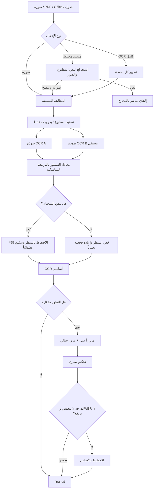
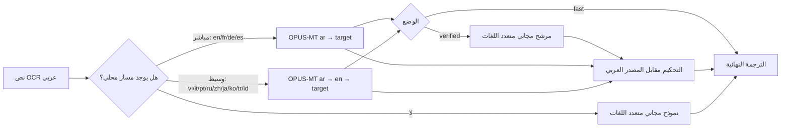

[English](README.md) | [Tiếng Việt](README.vi.md) | **العربية**

# خط معالجة OCR للنصوص العربية

Arabic OCR Pipeline أداة لاستخراج النص العربي من الصور والمستندات المختلطة. تجمع الملفات التعريفية المدفوعة بين معالجة الصورة بأسلوب ماسح المستندات، وعدة نماذج رؤية ولغة عبر OpenRouter، ومقارنة نتيجتين مستقلتين، وإعادة فحص مواضع الاختلاف، والتحسين بالتلقين التطوري. أما الملف التعريفي `--free` فهو مسار محلي أخف يستخدم نموذج CRNN-CTC واحداً متخصصاً في الكتابة العربية اليدوية.

تدعم الأداة:

- صور المستندات: PNG وJPG/JPEG وWebP وBMP وTIFF.
- مستندات PDF وOffice: PDF وDOC/DOCX وPPT/PPTX/PTT/PTTX وXLS/XLSX وCSV وTSV وTXT.
- المستندات المختلطة: استخراج النص المطبوع مباشرة، وإجراء OCR للصور أو الصفحات الممسوحة فقط لتقليل استدعاءات API.
- الترجمة من العربية إلى 13 لغة باستخدام نماذج محلية ومجانية.
- أربعة مستويات للتكلفة والجودة: `--free` و`--lite` و`--high` و`--max`؛ الافتراضي هو `--lite`.
- سجلات تفصيلية للمعالجة المسبقة، ومخرجات النماذج، والتقييم، وإعادة المحاولة، والتكلفة التقديرية.

> [!IMPORTANT]
> هذه أداة مساعدة لقراءة المستندات وليست نظام نسخ قانونياً معتمداً. يجب أن يراجع قارئ للعربية الأسماء والمبالغ والتواريخ والكتابة اليدوية وكل محتوى ذي أثر قانوني مقابل الصورة الأصلية.

## 1. التوثيق

تُستخدم صيغة أوامر واحدة للصور وملفات PDF ومستندات Office. تغيّر الخيارات طريقة معالجة الإدخال، ولا يحتاج المستخدم إلى تشغيل كل وحدة على حدة.

### 1.1 إعداد البيئة

يلزم Python 3.10 أو أحدث، ويوصى بـ Python 3.12 على Windows.

```powershell
python -m venv .venv
.\.venv\Scripts\Activate.ps1
python -m pip install --upgrade pip
python -m pip install -r requirements.txt
```

أنشئ ملف `.env` في مجلد المشروع إذا كان الأمر سيستخدم OpenRouter:

```dotenv
OPENROUTER_API_KEY=sk-or-v1-...
```

لا يلزم LibreOffice أو Microsoft Office مع `pywin32` إلا لتحويل صيغ Office القديمة أو تصيير صفحات Office كاملة. يلزم Poppler فقط للوظائف المبنية على `pdf2image`؛ أما خط PDF الأساسي فيستخدم PyMuPDF. عند أول ترجمة محلية، تنزّل Transformers نماذج Helsinki-NLP وتحفظها في الذاكرة المؤقتة.

يستخدم ملف OCR التعريفي `--free` الحزمة `arabicocr-khatt` ونقطة التحقق `FixFips/arabicocr-khatt`. ينزّل التشغيل الأول النموذج من Hugging Face، ثم تعمل التشغيلات اللاحقة محلياً. يمكن ضبط `ARABICOCR_KHATT_DEVICE=cpu` أو `cuda` لاختيار الجهاز، و`ARABICOCR_KHATT_UPSCALE` لتغيير معامل التكبير؛ والقيمة التلقائية هي `2.0` للصور التي يقل عرضها عن 1500 بكسل.

### 1.2 الصيغة العامة

```text
python main.py <INPUT...> [DOCUMENT_MODE] [MODEL_PROFILE] [OCR_OPTIONS] [TRANSLATION_OPTIONS]
```

- `<INPUT...>` صورة أو مستند واحد أو أكثر. يمكن استخدام مسار مطلق أو نسبي، أو اسم الملف فقط إذا كان داخل `input/`.
- `[DOCUMENT_MODE]` يحدد معالجة ملفات PDF/Office التي تحتوي على نص مطبوع وصور ممسوحة معاً.
- `[MODEL_PROFILE]` يحدد تكلفة OCR وجودته؛ وعند حذفه يُستخدم `--lite`.
- `[OCR_OPTIONS]` تتحكم في المعالجة المسبقة والتلقين التطوري وإعادة استخدام النتائج.
- `[TRANSLATION_OPTIONS]` تسمح بإجراء OCR والترجمة في أمر واحد.

مثال:

```powershell
python main.py report.pdf --document-mode mixed --lite --translate en
```

امتدادات الصور المدعومة هي `.png` و`.jpg` و`.jpeg` و`.webp` و`.bmp` و`.tif` و`.tiff`. وامتدادات المستندات هي `.pdf` و`.doc` و`.docx` و`.ppt` و`.pptx` و`.ptt` و`.pttx` و`.xls` و`.xlsx` و`.csv` و`.tsv` و`.txt`.

### 1.3 أوضاع معالجة المستندات

لصورة واحدة:

```powershell
python main.py sample_1.jpg
```

الوضع الافتراضي لملفات PDF وOffice هو `--document-mode mixed`:

```powershell
python main.py report.pdf
# مكافئ للأمر:
python main.py report.pdf --document-mode mixed
```

في وضع `mixed`:

- يُستخرج النص المطبوع مباشرة بلا OCR أو تكلفة API لذلك النص.
- لا تُعالج وتُقرأ إلا الصفحات الممسوحة والصور المضمنة ذات الحجم الكافي.
- تحفظ العلامات مثل `[[OCR_PAGE_SCAN | page 2]]` و`[[OCR_IMAGE | page 3, image 1]]` رقم الصفحة ونوع المنطقة وترتيب الصورة.

لقراءة كل صفحة كما تظهر بصرياً، بما في ذلك النص المطبوع الموجود، استخدم:

```powershell
python main.py report.pdf --document-mode full-ocr
```

وضع `full-ocr` أبطأ ويستهلك استدعاءات API أكثر، لكنه مفيد عند تلف طبقة النص أو تعقيد ترتيب القراءة أو الحاجة إلى فحص التخطيط المرئي. يتطلب تصيير صفحات Office كاملة LibreOffice أو Microsoft Office.

### 1.4 ملفات نماذج OCR التعريفية

| الملف التعريفي | الغرض | النماذج المعتادة |
|---|---|---|
| `--free` | OCR محلي بلا API | ArabicOCR_KHATT CRNN-CTC فقط |
| `--lite` (الافتراضي) | تكلفة منخفضة | Claude Haiku 5.5 وGPT-6 Luna |
| `--high` | جودة أعلى | Haiku/Luna للمهام الخفيفة، وSonnet 5.5 للصور الصعبة، وOpus 5.5 للتحكيم |
| `--max` | أعلى جودة وتكلفة | Claude Opus 5.5 وGPT-6 Astra Pro |

هذه الخيارات متنافية. عند استخدام `--free` يتجاوز الخط المصنّف والمرشح B وإعادة الفحص بنموذج آخر وOCR القصاصات والتلقين التطوري. تُقسّم الصفحات الطويلة عند مناطق قليلة الحبر لمنع دمج السطور، لكن كل شريحة تُقرأ بالنموذج ArabicOCR_KHATT وحده. إذا تعذر تحميل النموذج أو تشغيله يتوقف الأمر برسالة واضحة، ولا ينتقل خفية إلى OpenRouter.

دليل الاختيار:

- بلا خيار ملف تعريفي: يُستخدم `--lite`، وهو مناسب لمعظم الحالات.
- OCR مجاني ومحلي للكتابة اليدوية: استخدم `--free`، وخصوصاً للصور القريبة من مجال بيانات KHATT.
- للمستندات الصعبة أو دقة أعلى: استخدم `--high`.
- استخدم `--max` للمستندات المهمة بعد تقدير التكلفة.

### 1.5 أوامر شائعة

OCR لملف واحد أو عدة ملفات بالإعداد الافتراضي:

```powershell
python main.py sample_1.jpg
python main.py sample_1.jpg sample_2.jpg report.pdf
```

OCR أسرع بتجاوز تلقيني إعادة المحاولة والتحكيم البصري:

```powershell
python main.py sample_1.jpg --lite --no-evolve
```

يقلل ذلك استدعاءات API، لكنه قد يخفض الجودة عندما تختلف النتائج الأولية. يتجاوز `--free` التطور دائماً ويشغّل ArabicOCR_KHATT محلياً فقط، فلا حاجة إلى `--no-evolve` معه.

إنشاء الصورة المعالجة مسبقاً فقط، بلا أي API:

```powershell
python main.py sample_1.jpg --preprocess-only
```

OCR والترجمة إلى عدة لغات:

```powershell
python main.py sample_1.jpg --translate en --translate vi
```

ترجمة محلية سريعة بلا استدعاء OpenRouter في مرحلة الترجمة:

```powershell
python main.py sample_1.jpg --translate vi --translation-mode fast
```

قد تستدعي مرحلة OCR واجهة API مع ذلك. إذا كان `output/<filename>/final.txt` موجوداً، فإن الأمر الذي يتضمن `--translate` يعيد استخدامه عندما تتطابق بصمة الإدخال ووضع المستند. أضف `--force-ocr` فقط لإعادة OCR:

```powershell
python main.py sample_1.jpg --translate vi --force-ocr
```

### 1.6 الترجمة

يمكن تكرار `--translate`. رموز اللغات المضبوطة هي `en` و`vi` و`fr` و`de` و`es` و`it` و`pt` و`ru` و`zh` و`ja` و`ko` و`tr` و`id`.

- `--translation-mode verified` هو الافتراضي: ينشئ مرشحاً محلياً مباشراً أو وسيطاً، ومرشحاً إضافياً مجانياً متعدد اللغات، ثم يستخدم حكماً للاختيار. للترجمة ملف تعريفي مستقل افتراضه `free`، بصرف النظر عن ملف OCR. يستدعي هذا الوضع OpenRouter، لكنه يستخدم نماذج مجانية افتراضياً.
- `--translation-mode fast` يستخدم الترجمة المحلية المباشرة أو المسار العربية ← الإنجليزية ← اللغة الهدف فقط، ولا يستدعي OpenRouter للترجمة.

لاستخدام حكم مدفوع، أضف `--translation-profile lite` أو `high` أو `max`. من دون هذا الخيار يُستخدم `--translation-profile free`.

مثال لترجمة PDF مختلط إلى الإنجليزية والفيتنامية؛ هنا يطبق `--lite` على OCR فقط، وتبقى الترجمة `free`:

```powershell
python main.py report.pdf --document-mode mixed --lite `
  --translate en --translate vi --translation-mode verified
```

لاستخدام OCR مجاني وحكم ترجمة `lite`:

```powershell
python main.py report.pdf --free --translate vi --translation-profile lite
```

### 1.7 مرجع CLI الأساسي

| الخيار | المعنى |
|---|---|
| `--free`, `--lite`, `--high`, `--max` | اختيار ملف OCR؛ الافتراضي `lite` |
| `--no-evolve` | تجاوز المرور الأعمى والجنائي والتحكيم النهائي |
| `--preprocess-only` | كتابة الصورة المحسنة والتقرير بلا OCR |
| `--document-mode mixed` | استخراج النص المطبوع وإجراء OCR للصور/المسوح فقط |
| `--document-mode full-ocr` | تصيير كل صفحة وإجراء OCR لها |
| `--translate LANG` | ترجمة الناتج؛ يمكن تكراره |
| `--translation-mode verified` | مقارنة المرشح المحلي ومتعدد اللغات ثم التحقق |
| `--translation-mode fast` | ترجمة محلية فقط، بلا OpenRouter |
| `--translation-profile free\|lite\|high\|max` | اختيار ملف حكم الترجمة؛ الافتراضي `free` |
| `--force-ocr` | تجاهل نتيجة OCR المخزنة قبل الترجمة |

```powershell
python main.py --help
python mark.py --help
python translate.py --help
```

لا يوجد خيار `--fast` يشمل الخط كله. أقرب إعداد OCR سريع هو `--lite --no-evolve`، بينما يؤثر `--translation-mode fast` في الترجمة فقط.

### 1.8 المخرجات والسجلات والذاكرة المؤقتة

```text
arabic-ocr/
├── input/
│   └── sample_1.jpg
├── log/<filename>/
│   ├── <filename>_preprocessed.png
│   ├── <filename>_modelA.txt
│   ├── <filename>_modelB.txt
│   ├── <filename>_draft.txt
│   ├── <filename>_retry.txt
│   ├── <filename>.final.json
│   └── <filename>.mark.json
└── output/<filename>/
    ├── final.txt
    └── translations/<lang>.txt
```

لا يُفحص مخزون OCR تلقائياً إلا عندما يتضمن الأمر `--translate` ولا يتضمن `--force-ocr`. تشغيل `python main.py sample_1.jpg` وحده يعيد OCR.

بعد كل أمر يطبع البرنامج عدد استدعاءات API والرموز والتكلفة. تكون `usage.cost` الفعلية من OpenRouter أولى إن توفرت؛ وإلا يقدّر `calculate_cost.py` التكلفة. يمكن تعديل جدول الأسعار عبر `OPENROUTER_PRICE_OVERRIDES`.

### 1.9 تقييم المخرجات

من دون حقيقة مرجعية، ينتج `mark.py` درجة وWER تقديرياً بواسطة حكم بصري:

```powershell
python mark.py input/sample_1.jpg output/sample_1/final.txt --lite
```

مع نص مرجعي راجعه إنسان، استخدم `--reference` لحساب WER/CER فعليين بمحاذاة Levenshtein:

```powershell
python mark.py input/sample_1.jpg output/sample_1/final.txt `
  --reference ground_truth/sample_1.txt `
  --report log/sample_1/exact-evaluation.json
```

## 2. الخوارزمية وتصميم الحل

### 2.1 نظرة عامة



### 2.2 خط OCR الأساسي

#### الخطوة 1: توجيه الإدخال

تدخل الصور إلى OCR مباشرة. في وضع `mixed` ينشئ `convert.py` تسلسلاً مرتباً من `DocumentPart`: النوع `text` نص مطبوع يُستخرج مباشرة، والنوع `image` صفحة ممسوحة أو صورة كبيرة تحتاج OCR. تُعد صفحة PDF ممسوحة إذا غطت صورة نقطية نحو 60% منها أو لم توجد طبقة نص. يصيّر `full-ocr` كل صفحة بدقة 220 DPI.

#### الخطوة 2: المعالجة المسبقة

يعمل `preprocess.py` على CPU: يكتشف حدود الورقة ويصحح المنظور عند موثوقية الهندسة، ويصحح الميل البسيط، ويكبر العرض نحو 2000 بكسل بحد أقصى 5 مرات، ويقدّر الخلفية ويوازن الإضاءة، ويطبق CLAHE وunsharp masking، وينشئ قناع حبر ثنائياً لتحليل التخطيط.

التدوير التلقائي للاتجاه معطل حالياً؛ يستدعي `main.py` المعالجة مع `apply_orientation=False`. تبقى توصية الاتجاه في البيانات الوصفية لكنها لا تُطبّق.

#### الخطوة 3: قص الفقرات

تزيل العمليات المورفولوجية الحدود والخطوط الطويلة، وتصل الحروف إلى مناطق كلمات/فقرات، وتدمج الصناديق المتقاربة، وترتب القراءة من أعلى إلى أسفل ومن اليمين إلى اليسار. يشترط حاجز الجودة عدداً معقولاً من المناطق، وتغطية 72% من الحبر على الأقل، وألا تكون الصناديق هي الصفحة كلها تقريباً. وإلا يعود الخط إلى OCR كامل الصفحة.

للصفحات المطبوعة، ينتج البرنامج OCR كامل الصفحة وOCR القصاصات، ثم يختار حكم بصري الأكثر اكتمالاً وصحة في الترتيب. إذا فشل الحكم، لا تُختار القصاصات إلا إذا حافظت على 90% من الحروف العربية واحتوت علامات `[غير واضح]` أقل.

#### الخطوة 4: تصنيف المستند

يعيد المصنف البصري `{"type": "printed|handwritten|mixed", "confidence": 0.0}`. تُحوّل الصفحة `printed` ذات الثقة الأقل من 70% إلى `mixed` لتجنب مسار نموذج ضعيف.

#### الخطوة 5: مروران مستقلان لـ OCR

يُختار النموذج A بحسب نوع الصفحة، ويعطي النموذج B رأياً ثانياً مستقلاً. تطلب التلقينات نسخاً حرفياً، وحفظ الحركات الظاهرة، وعدم التصحيح أو الترجمة، واستخدام `[غير واضح]` فقط للمقاطع غير المقروءة فعلاً.

تُحاذى السطور عالمياً بالبرمجة الديناميكية. تكلفة الفجوة `0.45`، ويُعد التشابه المعياري `0.85` فأكثر اتفاقاً بشرط عدم الاختلاف حول `[غير واضح]`.

#### الخطوة 6: معالجة الاختلاف

- `agree`: الاحتفاظ بـ A وتدقيق 5% عشوائياً.
- `abstention`: إذا امتنع نموذج، تفضيل الآخر.
- `single_source`: حفظ السطر الوحيد مع تسجيل مصدره.
- `dispute`: إسقاط الكتلة على نطاقات السطور المكتشفة، وقصها، وإعادة فحص ذلك السطر بصرياً.
- عند فشل إعادة الفحص: حفظ النسختين في `[[UNRESOLVED | A: ... | B: ...]]` بدلاً من التخمين الصامت.

#### الخطوة 7: التلقين التطوري

بعد النتيجة الأساسية ينشئ `mark.py` نسخاً أعمى مستقلاً لتقليل الانحياز، ومروراً جنائياً يركز على التواريخ والأرقام والأسماء والنقاط والسطور المفقودة. يقارن حكم بصري الصورة والنتيجة الأساسية والمرورين وينشئ إعادة محاولة مع تقدير للدرجة وWER.

لا تستبدل إعادة المحاولة الأساس إلا إذا لم تنخفض الدرجة، ولم يرتفع WER التقديري، وتحسن مقياس واحد على الأقل تحسناً صارماً. تُحفظ النتائج والقرار في `log/`.

#### الخطوة 8: حساب التكلفة والتعافي

يُجمع استخدام API لكل نموذج. لا ينشئ `--free` استدعاءات API لـ OCR، ويسجل محرك ArabicOCR_KHATT والمدة والأخطاء، ويبقي النموذج في الذاكرة لإعادة استخدامه في الدفعات. تسجل الملفات الأخرى استخدام OpenRouter ليجمعه `calculate_cost.py`.

## 3. خط الترجمة

### 3.1 الأهداف

تعطي الترجمة الأولوية للأمانة على الأسلوب: تحفظ الأسماء والتواريخ والأرقام والعناوين وترتيب الفقرات وعلامات `[[OCR_...]]`، ولا تلخص أو تضيف محتوى. تستخدم مرشحات OpenRouter نماذج مجانية، ولا ينشئ `fast` أي استدعاء OpenRouter للترجمة.

### 3.2 المسار



في وضع `verified` يقارن المسار المحلي بمرشح مجاني متعدد اللغات ويحكم عليهما مقابل المصدر العربي. إذا لم يوجد مسار محلي يُستخدم المرشح متعدد اللغات وحده. تحفظ السجلات المرشح المحلي والوسيط الإنجليزي ومتعدد اللغات والفروق والاختيار النهائي.

في وضع `fast` تعمل النماذج المحلية المباشرة أو الوسيطة بالإنجليزية فقط. قد يحتاج التشغيل الأول إلى الإنترنت لتنزيل نماذج Hugging Face. اللغة التي لا تملك مساراً محلياً تُنتج خطأ بدلاً من استدعاء API خفية.

## 4. تقييم الفاعلية

### 4.1 دراسة أربع عينات باستخدام `--lite`

غطى تقرير 2026-10-17 نحو 1100 كلمة في أربع صور. قرأ نموذج لغوي المرجع من صور منخفضة الدقة ولم يراجعه قارئ عربي. عُد WER/CER يدوياً لا بمحاذاة Levenshtein، مع هامش معلن يقارب ±2 نقطة WER للمطبوع و±5 لليدوي.

| العينة | المحتوى | التقييم | WER صارم تقديري | الملاحظة الرئيسية |
|---|---|---:|---:|---|
| 1 | عقد يدوي، نحو 335 كلمة | 4/10 | ~32% (28–38%) | أخطاء كثيرة في الأسماء والأماكن والصياغات القانونية وتغيير للمعنى أحياناً |
| 2 | وكالة عربية وعبرية | 8/10 | ~4% للعربية؛ ~7–8% للصفحة | متن العربية جيد، والأسماء/الملاحظات العبرية اليدوية أضعف |
| 3 | كتاب مطبوع، نحو 88 كلمة | 9/10 | ~4.5% | السطور المطبوعة شبه صحيحة، والملاحظة اليدوية ناقصة |
| 4 | صفحة عقد مطبوعة، نحو 190 كلمة | 8.5/10 | ~4% للمطبوع؛ ~7% مع اليدوي المحذوف | المطبوع جيد لكن التواقيع والبصمات والملاحظات مفقودة |

بلغ WER الصارم المجمع للنص العربي المطبوع في العينات 2–4 نحو 3%، لكن العينة أصغر من أن تدعم تعميماً. بقيت الكتابة اليدوية في العينة 1 نقطة الضعف الكبرى بنحو 32%. تشمل الأخطاء إعادة صياغة قانونية تبدو معقولة، لا مجرد استبدال أحرف. كثيراً ما تُفقد التواقيع والأختام والبصمات والهوامش اليدوية.

### 4.2 تقارير `mark.py` الداخلية

| العينة | درجة الأساس | درجة الإعادة | WER الأساسي المقدر | WER الإعادة المقدر | اختيار الإعادة |
|---|---:|---:|---:|---:|---:|
| 1 | 4.0 | 6.0 | 45% | 25% | نعم |
| 2 | 5.0 | 7.0 | 20% | 10% | نعم |
| 3 | 7.5 | 8.5 | 5% | 3% | نعم |
| 4 | 4.5 | 7.5 | 22% | 7% | نعم |
| **المتوسط** | **5.25** | **7.25** | **23%** | **11.25%** | **4/4** |

هذه تقييمات ذاتية لحكم بصري وليست WER مبنياً على حقيقة مرجعية. فائدتها محصورة في الاختيار بين مرشحات الخط نفسه.

### 4.3 بناء معيار موثوق

1. إعداد الحقيقة المرجعية بواسطة قارئ عربي، مع محكّم ثانٍ للمواد القانونية.
2. تعريف التطبيع للهمزة و`ة/ه` و`ى/ي` والترقيم والحركات و`[غير واضح]`.
3. فصل مجموعات المطبوع واليدوي والعربي/العبري والصور الفوتوغرافية والمسوح.
4. نشر WER/CER صارم ومتسامح، ونسبة المناطق المفقودة، وأخطاء الحقول الحرجة كالأسماء والأرقام والتواريخ.
5. عدم استخدام النموذج نفسه لإنشاء المرجع وتقييم الناتج.
6. التوسع إلى ما وراء أربع وثائق مترابطة من الخليل بين 1972 و1979.

## 5. الاستخدامات

يلائم الخط رقمنة الأرشيفات العربية، والاستخراج الأولي من العقود والنماذج، والبحث النصي الكامل في ملفات PDF الممسوحة، وفصل النص والصور في المستندات المختلطة، وإنشاء مسودات ترجمة متعددة اللغات قابلة للتتبع، وإعداد مرشحات للتصحيح البشري أو مجموعات الحقيقة المرجعية.

لا تستخدم ناتجاً غير مُراجع لاتخاذ قرارات قانونية أو مالية أو قرارات هوية أو توقيع.

## 6. القيود وخطة التطوير

- تصحيح الاتجاه معطل؛ يجب تدوير الإدخال مسبقاً.
- كاشف الفقرات خوارزمية CPU تقريبية ويعود إلى OCR كامل الصفحة للتخطيطات المعقدة.
- نقاط النهاية المجانية محدودة المعدل وغير مستقرة، وقد يحتفظ بعض المزودين بالبيانات لتحسين نماذجهم.
- يزيد التلقين التطوري استدعاءات API وقد يكرر أخطاء الأساس.
- ما زالت الكتابة اليدوية والأسماء والأماكن النادرة والمصطلحات القانونية والمناطق الصغيرة صعبة.
- العينات الأربع دراسة حالة وليست معياراً كافياً.

تشمل الخطط حقيقة مرجعية يراجعها بشر، وكواشف مخصصة للكتابة اليدوية والتوقيع والختم والبصمة، وقواميس مجال للتحذير لا للتصحيح التلقائي، والتحقق عبر الصفحات من الأرقام والتواريخ والأسماء، والتقييم على مجموعات مستندات عربية أكبر، وتصدير DOCX/PDF مع صناديق وثقة لكل منطقة.

## 7. الوحدات الأساسية

| الملف | الدور |
|---|---|
| `main.py` | CLI، توجيه الإدخال، تنسيق الخط، المحاذاة، الذاكرة المؤقتة، السجلات والمخرجات |
| `paid_ocr.py` | الملفات المدفوعة، التلقينات، عميل OpenRouter، التصنيف، OCR/القصاصات وإعادة الفحص |
| `preprocess.py` | تصحيح المنظور والميل وتحسين الصورة وكشف الفقرات |
| `convert.py` | قراءة PDF/Office/الجداول، وفصل النص والصورة، وتصيير الصفحة كاملة |
| `mark.py` | الإعادة العمياء/الجنائية، والتحكيم البصري، وWER/CER بالمرجع |
| `translate.py` | ترجمة محلية مباشرة/وسيطة، ومرشح متعدد اللغات، والتحقق |
| `calculate_cost.py` | تجميع الاستخدام وتقدير تكلفة النماذج |
| `requirements.txt` | إصدارات الاعتماديات المستخدمة في بيئة المشروع |

## 8. ملاحظات للمستخدم

- **لا تعامل الناتج كنسخة قانونية معتمدة.** راجع الأسماء والأماكن والمبالغ والتواريخ والبنود والكتابة والأختام والتواقيع مع الأصل وقارئ عربي.
- **اختر وضع المستند الصحيح.** `mixed` افتراضي للملفات ذات طبقة النص الجيدة؛ أما `full-ocr` فأبطأ وأغلى لكنه مفيد للمسوح وطبقات النص التالفة.
- **`--free` متخصص في كتابة تشبه KHATT.** قد يضعف مع المطبوع والتخطيط المعقد والصور المنحنية أو الضبابية والأساليب الخارجة عن المجال، ولا يملك fallback إلى API عمداً.
- **`--translation-mode fast` يعفي مرحلة الترجمة فقط من API.** قد يستدعي OCR الملف المختار ما لم يوجد مخزون صالح.
- **المخزون مرتبط بمسار الترجمة.** أوامر OCR العادية تعيد OCR؛ استخدم `--force-ocr` لتجاوز المخزون صراحة أثناء الترجمة.
- **استخدم أسماء إدخال أساسية مختلفة.** يشترك `report.pdf` و`report.jpg` في `output/report/` وقد يكتب أحدهما فوق الآخر. ضع المسارات ذات المسافات بين علامتي اقتباس.
- **الكتابة اليدوية عالية الخطورة.** تحتاج المصادر الضبابية أو المائلة أو المظللة أو المقتطعة أو اليدوية إلى مراجعة أدق.
- **تصحيح الاتجاه معطل.** دوّر الصور ذات 90°/180° قبل التشغيل.
- **WER التقديري ليس WER حقيقياً.** يتطلب WER/CER الموثوق حقيقة مرجعية بشرية عبر `mark.py --reference`.
- **قدّر التكلفة قبل الدفعات الكبيرة.** تزيد `--high` و`--max` و`full-ocr` وتعدد لغات الترجمة والتطور عدد الاستدعاءات.
- **احم البيانات الحساسة.** لا ترفع `.env` أو مفاتيح API. تُرسل صور OCR إلى OpenRouter/المزودين، ويحتوي `log/` على صور ونصوص وسيطة.
- **احتفظ بالسجلات للتدقيق.** تساعد نتائج A/B وإعادة المحاولة والتقييم وتقارير JSON في تحديد مصدر الخطأ: المعالجة المسبقة أو OCR أو التحكيم أو الترجمة.
