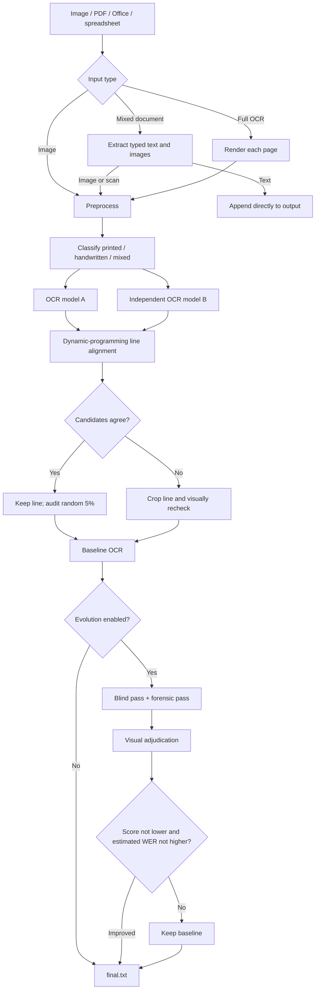
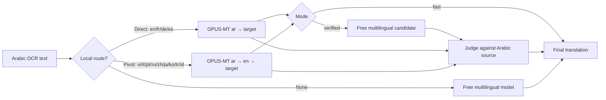

**English** | [Tiếng Việt](README.vi.md) | [العربية](README.ar.md)

# Arabic OCR Pipeline

Arabic OCR Pipeline extracts Arabic text from images and mixed documents. Paid profiles combine document-scanner-style preprocessing, multiple vision-language models through OpenRouter, independent OCR comparison, targeted rechecks, and evolutionary prompting. The `--free` profile is a smaller local-only path using one Arabic handwriting CRNN-CTC model.

Supported capabilities:

- Document images: PNG, JPG/JPEG, WebP, BMP, and TIFF.
- PDF and Office documents: PDF, DOC/DOCX, PPT/PPTX/PTT/PTTX, XLS/XLSX, CSV, TSV, and TXT.
- Mixed documents: extract typed text directly and OCR only embedded images or scanned pages, reducing API calls.
- Arabic translation into 13 languages with local and free models.
- Four OCR cost/quality profiles: `--free`, `--lite`, `--high`, and `--max`; the default is `--lite`.
- Detailed logs for preprocessing, model outputs, evaluation, retries, and estimated cost.

> [!IMPORTANT]
> This is a document-reading aid, not a legally certified transcription system. Names, monetary values, dates, handwriting, and legally significant content must always be checked against the source image by an Arabic reader.

## 1. Documentation

The same command format works for images, PDFs, and Office files. Options change how the input is processed; individual modules do not need to be called separately.

### 1.1 Environment setup

Python 3.10 or later is required. Python 3.12 is recommended on Windows.

```powershell
python -m venv .venv
.\.venv\Scripts\Activate.ps1
python -m pip install --upgrade pip
python -m pip install -r requirements.txt
```

Create a `.env` file in the project directory when a command will use OpenRouter:

```dotenv
OPENROUTER_API_KEY=sk-or-v1-...
```

LibreOffice or Microsoft Office with `pywin32` is only needed for converting legacy Office formats or rendering complete Office pages. Poppler is only needed for `pdf2image` functionality; the primary PDF pipeline uses PyMuPDF. On first use, local translation downloads Helsinki-NLP models through Transformers and caches them.

The `--free` OCR profile uses `arabicocr-khatt` and the `FixFips/arabicocr-khatt` checkpoint. Its first run downloads the checkpoint from Hugging Face; later runs are local. Set `ARABICOCR_KHATT_DEVICE=cpu` or `cuda` to select a device. `ARABICOCR_KHATT_UPSCALE` overrides the image scale factor; by default, images narrower than 1,500 px use `2.0`.

### 1.2 General syntax

```text
python main.py <INPUT...> [DOCUMENT_MODE] [MODEL_PROFILE] [OCR_OPTIONS] [TRANSLATION_OPTIONS]
```

- `<INPUT...>` is one or more images or documents. Use an absolute path, a relative path, or only the filename when it is inside `input/`.
- `[DOCUMENT_MODE]` controls how PDFs and Office files containing both typed text and scans are handled.
- `[MODEL_PROFILE]` controls OCR cost and quality; omitting it selects `--lite`.
- `[OCR_OPTIONS]` control preprocessing, evolutionary prompting, and cache reuse.
- `[TRANSLATION_OPTIONS]` allow OCR and translation in one command.

Example:

```powershell
python main.py report.pdf --document-mode mixed --lite --translate en
```

Supported image extensions are `.png`, `.jpg`, `.jpeg`, `.webp`, `.bmp`, `.tif`, and `.tiff`. Supported document extensions are `.pdf`, `.doc`, `.docx`, `.ppt`, `.pptx`, `.ptt`, `.pttx`, `.xls`, `.xlsx`, `.csv`, `.tsv`, and `.txt`.

### 1.3 Document processing modes

For a single image:

```powershell
python main.py sample_1.jpg
```

PDF and Office files default to `--document-mode mixed`:

```powershell
python main.py report.pdf
# Equivalent:
python main.py report.pdf --document-mode mixed
```

In `mixed` mode:

- Typed text is extracted directly, with no OCR or API cost for that text.
- Only scanned pages and sufficiently large embedded images are preprocessed and OCRed.
- Markers such as `[[OCR_PAGE_SCAN | page 2]]` and `[[OCR_IMAGE | page 3, image 1]]` preserve page, region type, and image order.

To OCR every page exactly as rendered, including existing typed text, use:

```powershell
python main.py report.pdf --document-mode full-ocr
```

`full-ocr` is slower and uses more API calls, but is useful for broken text layers, complex reading order, or visual-layout verification. Full-page Office rendering requires LibreOffice or Microsoft Office.

### 1.4 OCR model profiles

| Profile | Purpose | Typical models |
|---|---|---|
| `--free` | Local OCR, no API | ArabicOCR_KHATT CRNN-CTC only |
| `--lite` (default) | Low-cost default | Claude Haiku 5.5 and GPT-6 Luna |
| `--high` | Higher quality | Haiku/Luna for light tasks, Sonnet 5.5 for difficult OCR, Opus 5.5 for adjudication |
| `--max` | Highest quality and cost | Claude Opus 5.5 and GPT-6 Astra Pro |

Profile flags are mutually exclusive. Under `--free`, the pipeline skips classification, candidate B, cross-model rechecks, crop OCR by another model, and evolutionary prompting. Tall pages are split at low-ink regions so the recognizer does not merge lines; every strip is still recognized only by ArabicOCR_KHATT. If the model cannot load or run, the command stops with a clear error and never silently falls back to OpenRouter.

Selection guide:

- No profile flag: `--lite`, suitable for most cases.
- No paid/API handwriting OCR: `--free`, best for images close to the KHATT data domain.
- Difficult documents or higher accuracy: `--high`.
- Important documents after estimating cost: `--max`.

### 1.5 Common commands

OCR one or more files with the default profile:

```powershell
python main.py sample_1.jpg
python main.py sample_1.jpg sample_2.jpg report.pdf
```

Faster OCR by skipping the two retry prompts and visual adjudication:

```powershell
python main.py sample_1.jpg --lite --no-evolve
```

This reduces API calls but may reduce quality when initial candidates disagree. `--free` always skips evolution and runs only local ArabicOCR_KHATT, so `--no-evolve` is unnecessary there.

Generate only the preprocessed image, with no API calls:

```powershell
python main.py sample_1.jpg --preprocess-only
```

OCR and translate into multiple languages:

```powershell
python main.py sample_1.jpg --translate en --translate vi
```

Use local-only translation with no OpenRouter calls for the translation stage:

```powershell
python main.py sample_1.jpg --translate vi --translation-mode fast
```

OCR may still call an API. When `output/<filename>/final.txt` already exists, a command containing `--translate` reuses it if the input signature and document mode match. Add `--force-ocr` only when OCR must be rerun:

```powershell
python main.py sample_1.jpg --translate vi --force-ocr
```

### 1.6 Translation

`--translate` is repeatable. Configured codes are `en`, `vi`, `fr`, `de`, `es`, `it`, `pt`, `ru`, `zh`, `ja`, `ko`, `tr`, and `id`.

- `--translation-mode verified` is the default. It creates a local direct/pivot candidate, adds a free multilingual candidate, and uses a judge to select the result. Translation has its own `free` profile by default, independent of the OCR profile. It still calls OpenRouter, but uses free models unless overridden.
- `--translation-mode fast` uses only local direct translation or Arabic → English → target. It makes no OpenRouter calls for translation.

To use a paid judge, add `--translation-profile lite`, `high`, or `max`. Without this option, `--translation-profile free` is used.

Example: translate a mixed PDF into English and Vietnamese. Here `--lite` applies only to OCR, while translation remains `free`:

```powershell
python main.py report.pdf --document-mode mixed --lite `
  --translate en --translate vi --translation-mode verified
```

To use free OCR but a lite translation judge:

```powershell
python main.py report.pdf --free --translate vi --translation-profile lite
```

### 1.7 Main CLI reference

| Option | Meaning |
|---|---|
| `--free`, `--lite`, `--high`, `--max` | Select OCR profile; default: `lite` |
| `--no-evolve` | Skip blind pass, forensic pass, and final adjudication |
| `--preprocess-only` | Write the enhanced image and report without OCR |
| `--document-mode mixed` | Extract typed text and OCR only images/scans |
| `--document-mode full-ocr` | Render and OCR every page |
| `--translate LANG` | Translate output; may be repeated |
| `--translation-mode verified` | Compare local and multilingual candidates, then verify |
| `--translation-mode fast` | Local translation only; no OpenRouter calls |
| `--translation-profile free\|lite\|high\|max` | Select translation judge profile; default: `free` |
| `--force-ocr` | Ignore an existing OCR cache before translation |

```powershell
python main.py --help
python mark.py --help
python translate.py --help
```

There is no pipeline-wide `--fast` flag. The closest fast OCR setup is `--lite --no-evolve`; `--translation-mode fast` only affects translation.

### 1.8 Output, logs, and cache

```text
arabic-ocr/
├── input/
│   └── sample_1.jpg
├── log/<filename>/
│   ├── <filename>_preprocessed.png
│   ├── <filename>_modelA.txt
│   ├── <filename>_modelB.txt
│   ├── <filename>_draft.txt
│   ├── <filename>_retry.txt
│   ├── <filename>.final.json
│   └── <filename>.mark.json
└── output/<filename>/
    ├── final.txt
    └── translations/<lang>.txt
```

OCR cache is considered automatically only when the command contains `--translate` and does not contain `--force-ocr`. Running `python main.py sample_1.jpg` alone performs OCR again.

After each command, the program prints API calls, tokens, and cost. Actual `usage.cost` from OpenRouter takes priority; otherwise `calculate_cost.py` estimates cost. Override its price table with `OPENROUTER_PRICE_OVERRIDES`.

### 1.9 Output evaluation

Without ground truth, `mark.py` produces a score and estimated WER through a visual judge:

```powershell
python mark.py input/sample_1.jpg output/sample_1/final.txt --lite
```

With a human-reviewed transcript, use `--reference` for exact Levenshtein WER/CER:

```powershell
python mark.py input/sample_1.jpg output/sample_1/final.txt `
  --reference ground_truth/sample_1.txt `
  --report log/sample_1/exact-evaluation.json
```

## 2. Algorithm and solution design

### 2.1 Overview



### 2.2 Main OCR pipeline

#### Step 1: Input routing

Images enter OCR directly. For PDF/Office in `mixed` mode, `convert.py` creates an ordered sequence of `DocumentPart` values: `text` is extracted directly, while `image` identifies a scanned page or sufficiently large embedded image requiring OCR. A PDF page is treated as scanned when a raster covers roughly 60% or more of it, or when no text layer exists. `full-ocr` renders every page at 220 DPI.

#### Step 2: Preprocessing

`preprocess.py` runs on CPU: it detects document edges and applies perspective correction when reliable, deskews small angles, upscales toward 2,000 px width (up to 5×), estimates the background, normalizes lighting, applies CLAHE and unsharp masking, and creates a binary ink mask for layout analysis.

Automatic orientation rotation is currently disabled: `main.py` calls preprocessing with `apply_orientation=False`. The heuristic recommendation remains in metadata but is not applied.

#### Step 3: Paragraph crops

Morphology removes borders and long rules, joins characters into word/paragraph regions, merges nearby boxes, and sorts reading order from top to bottom and right to left. A quality gate requires a reasonable region count, at least 72% ink coverage, and boxes that are not effectively the whole page. Otherwise, full-page OCR is used.

For printed pages, both full-page and crop OCR are produced, and a vision judge selects the more complete, correctly ordered output. If judging fails, crops are selected only when they retain at least 90% of Arabic characters and contain fewer `[غير واضح]` markers.

#### Step 4: Document classification

The vision classifier returns `{"type": "printed|handwritten|mixed", "confidence": 0.0}`. A `printed` page below 70% confidence is routed as `mixed` to avoid an overly weak model path.

#### Step 5: Independent OCR passes

Model A is selected by page type; model B supplies an independent second opinion. Prompts require verbatim transcription, preserved diacritics when visible, no correction or translation, and `[غير واضح]` only for genuinely unreadable spans.

Lines are globally aligned through dynamic programming. Gap cost is `0.45`; normalized similarity of at least `0.85`, with no disagreement over `[غير واضح]`, counts as agreement.

#### Step 6: Resolving disagreement

- `agree`: keep A and audit a random 5%.
- `abstention`: if one model abstains, prefer the other.
- `single_source`: retain the only line but record its source.
- `dispute`: project the aligned block onto detected image bands, crop it, and visually recheck that line.
- Failed recheck: preserve both versions as `[[UNRESOLVED | A: ... | B: ...]]` rather than silently guessing.

#### Step 7: Evolutionary prompting

After the baseline, `mark.py` produces a blind transcription to reduce anchoring and a forensic pass focused on dates, numbers, names, dots, and omitted lines. A visual judge compares the image, baseline, blind pass, and forensic pass, generating a retry with score/WER estimates.

The retry replaces the baseline only if its score is not lower, estimated WER is not higher, and at least one metric strictly improves. Both candidates and the decision remain in `log/`.

#### Step 8: Cost accounting and recovery

API usage is aggregated per model. `--free` makes no OCR API calls and records ArabicOCR_KHATT engine, duration, and errors while retaining the model in memory for batch reuse. Other profiles record OpenRouter usage for `calculate_cost.py`.

## 3. Translation pipeline

### 3.1 Goals

Translation prioritizes fidelity over style: preserve names, dates, numbers, headings, paragraph order, and `[[OCR_...]]` markers; never summarize or invent content. OpenRouter candidates are free models, and `fast` makes no OpenRouter translation calls.

### 3.2 Flow



In `verified` mode, a local route is compared with a free multilingual candidate and judged against the Arabic source. Without a local route, the multilingual candidate is used alone. Logs preserve local, pivot, multilingual, diff, and selected outputs.

In `fast` mode, only local direct or English-pivot models run. The first run may need Internet access to download Hugging Face models. An unsupported local route raises an error instead of silently using an API.

## 4. Effectiveness evaluation

### 4.1 Four-sample `--lite` case study

The 2026-10-17 report covered roughly 1,100 words across four images. Its reference was read by an LLM from low-resolution images and was not verified by an Arabic reader. WER/CER was counted manually rather than by Levenshtein alignment, with reported uncertainty of about ±2 WER points for print and ±5 for handwriting.

| Sample | Content | Overall | Estimated strict WER | Main finding |
|---|---|---:|---:|---|
| 1 | Handwritten contract, ~335 words | 4/10 | ~32% (28–38%) | Many names, places, and legal phrases wrong; some meaning-changing paraphrase |
| 2 | Arabic + Hebrew authorization | 8/10 | ~4% Arabic; ~7–8% whole page | Arabic body good; handwritten Hebrew names/notes weaker |
| 3 | Typed letter, ~88 words | 9/10 | ~4.5% | Printed lines nearly correct; handwritten note incomplete |
| 4 | Typed contract page, ~190 words | 8.5/10 | ~4% print; ~7% including omitted handwriting | Good print, but signatures/fingerprints/notes omitted |

Printed Arabic in samples 2–4 was approximately 3% pooled strict WER, but the sample is too small for general claims. Sample 1 handwriting remained the primary weakness at roughly 32%. Errors include plausible legal rewrites, not just character substitutions. Signatures, stamps, fingerprints, and marginal handwriting are frequently missed.

### 4.2 Internal `mark.py` reports

| Sample | Baseline score | Retry score | Baseline estimated WER | Retry estimated WER | Retry selected |
|---|---:|---:|---:|---:|---:|
| 1 | 4.0 | 6.0 | 45% | 25% | Yes |
| 2 | 5.0 | 7.0 | 20% | 10% | Yes |
| 3 | 7.5 | 8.5 | 5% | 3% | Yes |
| 4 | 4.5 | 7.5 | 22% | 7% | Yes |
| **Average** | **5.25** | **7.25** | **23%** | **11.25%** | **4/4** |

These are vision-judge self-evaluations, not ground-truth WER. They are useful only for choosing between candidates inside this pipeline.

### 4.3 Building a reliable benchmark

1. Have an Arabic reader produce ground truth; use a second adjudicator for legal material.
2. Define normalization for hamza, `ة/ه`, `ى/ي`, punctuation, diacritics, and `[غير واضح]`.
3. Separate printed, handwritten, Arabic/Hebrew, photographed, and scanned sets.
4. Report strict and lenient WER/CER, missed-region rate, and critical-field errors for names, numbers, and dates.
5. Do not use the same model to create both reference and evaluation.
6. Expand beyond four related Hebron documents from 1972–1979.

## 5. Applications

Suitable uses include Arabic archive digitization, preliminary extraction from contracts and forms, full-text search over scanned PDFs, mixed-document text/image separation, traceable multilingual draft translation, and creation of candidates for human correction or ground-truth datasets.

Do not use unreviewed output for legal, financial, identity, or signature decisions.

## 6. Limitations and roadmap

- Orientation correction is disabled; rotate inputs beforehand.
- Paragraph detection is a CPU heuristic and falls back to full-page OCR for complex layouts.
- Free endpoints have unstable availability and rate limits; some providers may retain data for model improvement.
- Evolutionary prompting increases API calls and can share baseline errors.
- Handwriting, rare names and places, legal terminology, and small regions remain difficult.
- Four samples are a case study, not a sufficient benchmark.

Planned work includes human-reviewed ground truth, dedicated detectors for handwriting/signatures/stamps/fingerprints, domain lexicons used only for warnings, cross-page verification of numbers/dates/names, evaluation on larger Arabic document datasets, and DOCX/PDF export with bounding boxes and confidence.

## 7. Main modules

| File | Role |
|---|---|
| `main.py` | CLI, input routing, orchestration, alignment, caching, logs, and output |
| `paid_ocr.py` | Paid profiles, prompts, OpenRouter client, classification, OCR/crops, and rechecks |
| `preprocess.py` | Perspective correction, deskew, enhancement, and paragraph detection |
| `convert.py` | PDF/Office/spreadsheet reading, text/image separation, and full-page rendering |
| `mark.py` | Blind/forensic retries, visual adjudication, and reference WER/CER |
| `translate.py` | Local direct/pivot translation, multilingual candidate, and verification |
| `calculate_cost.py` | Usage aggregation and model-cost estimation |
| `requirements.txt` | Dependency versions used in the project environment |

## 8. User notes

- **Do not treat output as a certified legal copy.** Verify names, places, money, dates, clauses, handwriting, seals, and signatures with the original and an Arabic reader.
- **Choose the right document mode.** `mixed` is the default for files with a good text layer; `full-ocr` is slower and more expensive but helps with scans and broken text layers.
- **`--free` is specialized for KHATT-like handwriting.** It may perform poorly on print, complex layouts, curved/blurred images, or out-of-domain styles, and intentionally has no API fallback.
- **`--translation-mode fast` only removes API use from translation.** OCR may still call the selected profile unless a valid cache exists.
- **Cache is translation-specific.** Ordinary OCR commands rerun OCR; use `--force-ocr` to bypass cache explicitly during translation.
- **Use unique input stems.** `report.pdf` and `report.jpg` both map to `output/report/` and can overwrite one another. Quote paths containing spaces.
- **Handwriting is high risk.** Blurred, skewed, shadowed, cropped, or handwritten sources require closer review.
- **Orientation correction is disabled.** Rotate 90°/180° inputs before running.
- **Estimated WER is not exact WER.** Reliable WER/CER requires human-reviewed ground truth passed through `mark.py --reference`.
- **Estimate cost before large batches.** `--high`, `--max`, `full-ocr`, multiple translation targets, and evolution all increase calls.
- **Protect sensitive data.** Never commit `.env` or API keys. OCR images are sent to OpenRouter/providers, while `log/` contains intermediate images and transcripts.
- **Keep logs for audits.** Model A/B, retry, evaluation, and JSON reports help locate whether an error came from preprocessing, OCR, adjudication, or translation.
