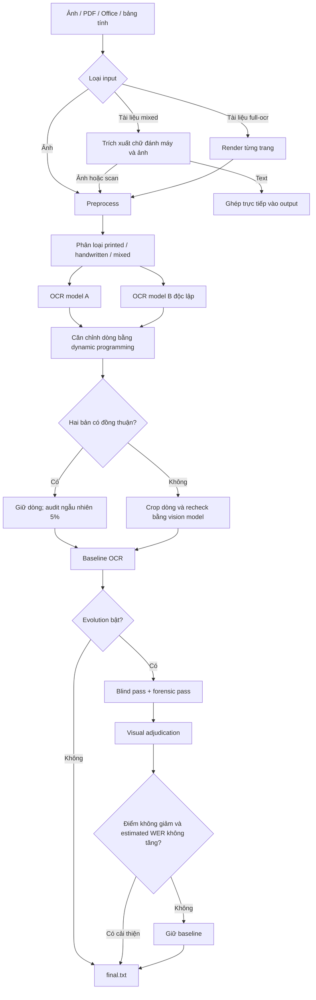
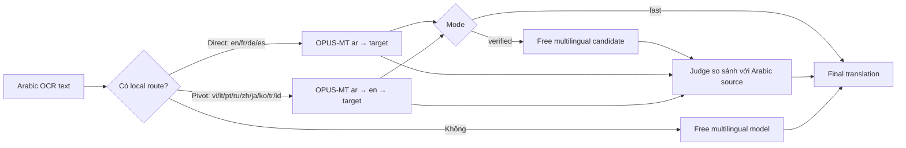

# Arabic OCR Pipeline

Arabic OCR Pipeline là công cụ nhận dạng văn bản tiếng Ả Rập từ ảnh và tài liệu hỗn hợp. Các profile có phí kết hợp tiền xử lý ảnh kiểu máy quét tài liệu, nhiều vision-language model qua OpenRouter, so sánh chéo hai bản OCR, kiểm tra lại các dòng bất đồng và evolutionary prompting. Profile `--free` là nhánh local gọn hơn, chỉ dùng một model CRNN-CTC chuyên chữ viết tay Ả Rập.

Công cụ hỗ trợ:

- Ảnh tài liệu: PNG, JPG/JPEG, WebP, BMP, TIFF.
- PDF và tài liệu Office: PDF, DOC/DOCX, PPT/PPTX/PTT/PTTX, XLS/XLSX, CSV, TSV và TXT.
- Tài liệu hỗn hợp: lấy chữ đánh máy trực tiếp và chỉ OCR ảnh/trang scan để giảm API call.
- Dịch từ tiếng Ả Rập sang 13 ngôn ngữ bằng model cục bộ và model miễn phí.
- Bốn mức chi phí/chất lượng: `--free`, `--lite`, `--high`, `--max`; mặc định là `--lite`.
- Log đầy đủ cho preprocessing, từng model, đánh giá, bản retry và chi phí ước tính.

> [!IMPORTANT]
> Đây là công cụ hỗ trợ đọc tài liệu, không phải hệ thống chứng thực pháp lý. Với tên riêng, số tiền, ngày tháng, chữ viết tay hoặc tài liệu có hệ quả pháp lý, luôn cần người biết tiếng Ả Rập đối chiếu với ảnh gốc.

## 1. Documentation

Phần này dùng một cú pháp chung cho ảnh, PDF và tài liệu Office. Các tùy chọn chỉ thay đổi cách chương trình xử lý input; người dùng không cần gọi từng module riêng lẻ.

### 1.1 Chuẩn bị môi trường

Yêu cầu Python 3.10 trở lên; Python 3.12 được khuyến nghị trên Windows.

```powershell
python -m venv .venv
.\.venv\Scripts\Activate.ps1
python -m pip install --upgrade pip
python -m pip install -r requirements.txt
```

Tạo `.env` trong thư mục dự án nếu lệnh sẽ gọi OpenRouter:

```dotenv
OPENROUTER_API_KEY=sk-or-v1-...
```

LibreOffice hoặc Microsoft Office + `pywin32` chỉ cần khi chuyển đổi định dạng Office cũ hoặc render toàn trang Office. Poppler chỉ cần cho chức năng dựa trên `pdf2image`; pipeline PDF chính dùng PyMuPDF. Lần đầu dịch local, Transformers sẽ tải các model Helsinki-NLP rồi lưu vào cache cho những lần sau.

Profile `--free` dùng package `arabicocr-khatt` và checkpoint `FixFips/arabicocr-khatt`. Lần đầu chạy, package tải checkpoint từ Hugging Face rồi giữ trong cache; các lần sau chạy local. Có thể đặt `ARABICOCR_KHATT_DEVICE=cpu` hoặc `cuda` để chọn thiết bị, và `ARABICOCR_KHATT_UPSCALE` để ghi đè hệ số phóng ảnh (mặc định tự chọn `2.0` nếu ảnh rộng dưới 1500 px).

### 1.2 Cú pháp tổng quát

```text
python main.py <INPUT...> [DOCUMENT_MODE] [MODEL_PROFILE] [OCR_OPTIONS] [TRANSLATION_OPTIONS]
```

Trong đó:

- `<INPUT...>` là một hoặc nhiều ảnh/tài liệu. Có thể dùng đường dẫn đầy đủ, đường dẫn tương đối hoặc chỉ ghi tên file nếu file nằm trong `input/`.
- `[DOCUMENT_MODE]` quyết định cách xử lý PDF/Office có cả chữ đánh máy và ảnh scan.
- `[MODEL_PROFILE]` quyết định mức chi phí và chất lượng OCR; nếu bỏ qua sẽ dùng `--lite`.
- `[OCR_OPTIONS]` điều khiển preprocessing, evolutionary prompting và việc dùng lại kết quả.
- `[TRANSLATION_OPTIONS]` có thể vừa OCR vừa dịch trong cùng một lệnh.

Ví dụ tổng quát:

```powershell
python main.py report.pdf --document-mode mixed --lite --translate en
```

Các định dạng được hỗ trợ:

- Ảnh: `.png`, `.jpg`, `.jpeg`, `.webp`, `.bmp`, `.tif`, `.tiff`.
- Tài liệu: `.pdf`, `.doc`, `.docx`, `.ppt`, `.pptx`, `.ptt`, `.pttx`, `.xls`, `.xlsx`, `.csv`, `.tsv`, `.txt`.

### 1.3 Chọn cách xử lý tài liệu

Với một ảnh đơn, chỉ cần truyền ảnh vào lệnh:

```powershell
python main.py sample_1.jpg
```

Với PDF hoặc Office, mặc định là `--document-mode mixed`:

```powershell
python main.py report.pdf
# Tương đương:
python main.py report.pdf --document-mode mixed
```

Chế độ `mixed` phù hợp cho tài liệu thông thường có cả chữ đánh máy và ảnh:

- Chữ đánh máy được trích xuất trực tiếp, không đưa qua OCR và không tốn API cho phần đó.
- Trang scan và ảnh nhúng đủ lớn mới được tiền xử lý và OCR.
- Các marker như `[[OCR_PAGE_SCAN | page 2]]` và `[[OCR_IMAGE | page 3, image 1]]` ghi lại trang, loại vùng và thứ tự ảnh.

Nếu muốn OCR mọi trang đúng như hình nhìn thấy, kể cả phần đã có chữ đánh máy, dùng:

```powershell
python main.py report.pdf --document-mode full-ocr
```

`full-ocr` tốn thời gian và API call hơn, nhưng hữu ích khi text layer bị lỗi, thứ tự đọc phức tạp hoặc cần kiểm tra bố cục hiển thị. Với file Office, chế độ này cần LibreOffice hoặc Microsoft Office để render tài liệu.

### 1.4 Chọn profile model

| Profile | Mục tiêu | Model điển hình |
|---|---|---|
| `--free` | OCR local, không API | ArabicOCR_KHATT CRNN-CTC, một model duy nhất |
| `--lite` (mặc định) | Chi phí thấp, mặc định | Claude Haiku 5.5 và GPT-6 Luna |
| `--high` | Chất lượng cao như pipeline ban đầu | Haiku/Luna cho tác vụ nhẹ, Sonnet 5.5 cho OCR khó, Opus 5.5 để adjudicate |
| `--max` | Chất lượng cao nhất, chi phí cao | Claude Opus 5.5 và GPT-6 Astra Pro |

Các cờ profile loại trừ lẫn nhau. Với `--free`, pipeline bỏ classifier, candidate B, recheck, crop OCR bằng model khác và evolutionary prompting. Ảnh trang cao được chia thành các dải tại vùng ít nét mực để tránh page segmenter gộp dòng; mọi dải vẫn chỉ được nhận dạng bởi ArabicOCR_KHATT. Nếu model không tải/chạy được, lệnh báo lỗi rõ ràng và dừng, không âm thầm fallback sang OpenRouter.

Chọn nhanh theo nhu cầu:

- Không truyền profile: dùng `--lite`, phù hợp cho phần lớn trường hợp.
- Không muốn tốn phí/API cho OCR chữ viết tay: dùng `--free`; model phù hợp nhất với ảnh gần miền dữ liệu KHATT.
- Tài liệu khó hoặc cần độ chính xác cao hơn: dùng `--high`.
- Chỉ dùng `--max` cho tài liệu quan trọng sau khi đã ước lượng chi phí.

### 1.5 Các công thức chạy thường dùng

OCR một hoặc nhiều file bằng cấu hình mặc định:

```powershell
python main.py sample_1.jpg
python main.py sample_1.jpg sample_2.jpg report.pdf
```

OCR nhanh hơn bằng cách bỏ hai retry prompt và bước visual adjudication của evolutionary prompting:

```powershell
python main.py sample_1.jpg --lite --no-evolve
```

Chế độ này giảm API call nhưng có thể giảm chất lượng khi hai bản OCR ban đầu bất đồng. Riêng `--free` luôn bỏ evolution và chỉ chạy ArabicOCR_KHATT local, nên không cần thêm `--no-evolve`.

Chỉ xem ảnh sau preprocessing, hoàn toàn không gọi API:

```powershell
python main.py sample_1.jpg --preprocess-only
```

OCR và dịch sang nhiều ngôn ngữ trong một lần chạy:

```powershell
python main.py sample_1.jpg --translate en --translate vi
```

Dịch nhanh bằng model local, không phát sinh OpenRouter API call cho **phần dịch**:

```powershell
python main.py sample_1.jpg --translate vi --translation-mode fast
```

Lưu ý rằng OCR vẫn có thể gọi API. Muốn dịch một kết quả OCR đã tồn tại mà không OCR lại, giữ nguyên `output/<tên-tệp>/final.txt` và chạy lệnh có `--translate`; chương trình sẽ dùng cache nếu input và document mode còn phù hợp.

Chỉ khi muốn bỏ cache và OCR lại mới thêm:

```powershell
python main.py sample_1.jpg --translate vi --force-ocr
```

### 1.6 Dịch thuật

`--translate` có thể lặp lại. Các mã được cấu hình sẵn là `en`, `vi`, `fr`, `de`, `es`, `it`, `pt`, `ru`, `zh`, `ja`, `ko`, `tr` và `id`.

- `--translation-mode verified` là mặc định: tạo bản local direct/pivot, tạo thêm ứng viên multilingual miễn phí rồi dùng judge để chọn. Profile dịch mặc định là `free`, độc lập với profile OCR; vì vậy `--lite` trong ví dụ dưới chỉ áp dụng cho OCR. Chế độ này vẫn gọi OpenRouter nhưng mặc định chỉ dùng model miễn phí.
- `--translation-mode fast`: chỉ dùng tuyến dịch local direct hoặc Arabic → English → ngôn ngữ đích; không gọi OpenRouter cho phần dịch.

Muốn chủ động dùng judge trả phí, thêm `--translation-profile lite`, `high` hoặc `max`. Nếu không truyền tùy chọn này, chương trình dùng `--translation-profile free`.

Ví dụ dịch một PDF hỗn hợp sang Anh và Việt:

```powershell
python main.py report.pdf --document-mode mixed --lite `
  --translate en --translate vi --translation-mode verified
```

### 1.7 Tham chiếu CLI chính

| Tùy chọn | Ý nghĩa |
|---|---|
| `--free`, `--lite`, `--high`, `--max` | Chọn profile OCR; mặc định `lite` |
| `--no-evolve` | Bỏ blind pass, forensic pass và final adjudication |
| `--preprocess-only` | Chỉ tạo ảnh đã xử lý và report, không OCR |
| `--document-mode mixed` | Trích xuất chữ đánh máy, chỉ OCR ảnh/scan |
| `--document-mode full-ocr` | Render và OCR toàn bộ trang |
| `--translate LANG` | Dịch output; có thể lặp lại nhiều lần |
| `--translation-mode verified` | So sánh ứng viên local và multilingual rồi kiểm chứng |
| `--translation-mode fast` | Chỉ dùng model local, không gọi OpenRouter |
| `--translation-profile free\|lite\|high\|max` | Chọn profile judge cho bản dịch; mặc định `free` |
| `--force-ocr` | Không dùng OCR cache khi dịch |

Xem toàn bộ trợ giúp:

```powershell
python main.py --help
python mark.py --help
python translate.py --help
```

Không có cờ `--fast` chung cho toàn pipeline. Cấu hình gần nhất với “OCR nhanh” là `--lite --no-evolve`; còn `--translation-mode fast` chỉ làm phần dịch nhanh và không dùng API.

### 1.8 Output, log và cache

```text
arabic-ocr/
├── input/                         # ảnh/tài liệu đầu vào
│   └── sample_1.jpg
├── log/<tên-tệp>/                # preprocessing, transcript model và report
│   ├── <tên-tệp>_preprocessed.png
│   ├── <tên-tệp>_modelA.txt
│   ├── <tên-tệp>_modelB.txt
│   ├── <tên-tệp>_draft.txt
│   ├── <tên-tệp>_retry.txt
│   ├── <tên-tệp>.final.json
│   └── <tên-tệp>.mark.json
└── output/<tên-tệp>/
    ├── final.txt                  # OCR cuối cùng
    └── translations/<lang>.txt   # bản dịch, nếu có
```

Cache OCR chỉ được tự động xét khi lệnh có `--translate` và không có `--force-ocr`. Nếu chỉ chạy `python main.py sample_1.jpg`, pipeline sẽ OCR lại.

Sau mỗi lệnh, chương trình in số API call, token và chi phí. Nếu OpenRouter trả `usage.cost`, chi phí thực tế được ưu tiên; nếu không, `calculate_cost.py` dùng bảng giá ước tính. Có thể ghi đè bảng giá bằng biến `OPENROUTER_PRICE_OVERRIDES`.

### 1.9 Đánh giá output

Không có ground truth, `mark.py` chỉ tạo điểm và WER ước lượng bằng visual judge:

```powershell
python mark.py input/sample_1.jpg output/sample_1/final.txt --lite
```

Có transcript chuẩn do người duyệt, thêm `--reference` để tính WER/CER thật bằng Levenshtein:

```powershell
python mark.py input/sample_1.jpg output/sample_1/final.txt `
  --reference ground_truth/sample_1.txt `
  --report log/sample_1/exact-evaluation.json
```

## 2. Thuật toán và thiết kế giải pháp

### 2.1 Tổng quan



### 2.2 Phần 1 - OCR chính

#### Bước 1: Input routing

Ảnh đi thẳng vào pipeline OCR. Với PDF/Office ở chế độ `mixed`, `convert.py` tạo chuỗi `DocumentPart` theo thứ tự:

- `text`: chữ đánh máy được lấy trực tiếp;
- `image`: trang scan hoặc ảnh nhúng đủ lớn cần OCR.

PDF có raster phủ ít nhất khoảng 60% trang hoặc không có text layer được xem là scan. Chế độ `full-ocr` render tất cả trang ở 220 DPI trước khi OCR.

#### Bước 2: Preprocessing

`preprocess.py` thực hiện hoàn toàn trên CPU:

1. Tìm biên trang và perspective crop nếu hình học đủ tin cậy.
2. Deskew góc nghiêng nhỏ.
3. Upscale chiều rộng tới khoảng 2.000 px, tối đa 5 lần.
4. Chuyển grayscale và ước lượng nền bằng Gaussian blur.
5. Chuẩn hóa ánh sáng bằng phép chia nền.
6. Tăng tương phản cục bộ bằng CLAHE.
7. Unsharp masking và tạo binary ink mask cho bước phát hiện layout.

Pipeline hiện **không tự xoay orientation**: `main.py` gọi preprocessing với `apply_orientation=False`. Heuristic vẫn ghi orientation đề xuất vào metadata, nhưng không áp dụng phép xoay.

#### Bước 3: Phát hiện paragraph crop

Binary ink mask được xử lý morphology để:

- bỏ đường viền và đường kẻ dài;
- nối ký tự thành word/paragraph region;
- gộp các box lân cận;
- sắp thứ tự từ trên xuống, và phải sang trái trong cùng hàng.

Crop chỉ được dùng khi quality gate đạt yêu cầu: số vùng hợp lý, bắt được ít nhất 72% ink và không gần tương đương toàn trang. Nếu không đạt, pipeline quay về full-page OCR.

Với trang `printed`, chương trình OCR cả trang và từng crop, sau đó vision judge chọn bản giữ đủ nội dung và đúng thứ tự hơn. Nếu judge lỗi, heuristic chỉ chọn crop khi giữ ít nhất 90% ký tự Ả Rập và có ít `[غير واضح]` hơn.

#### Bước 4: Phân loại tài liệu

Vision classifier trả về:

```json
{"type": "printed|handwritten|mixed", "confidence": 0.0}
```

Trang `printed` có confidence dưới 70% được chuyển sang `mixed` để tránh dùng tuyến model yếu cho ảnh khó.

#### Bước 5: Hai lượt OCR độc lập

- Model A được chọn theo loại trang.
- Model B là model độc lập để tạo một “second opinion”.
- Prompt yêu cầu chép nguyên văn, giữ dấu nếu có, không sửa chính tả, không dịch và dùng `[غير واضح]` cho span thực sự không đọc được.

Hai danh sách dòng được căn chỉnh toàn cục bằng dynamic programming. Chi phí gap là `0.45`; hai dòng được xem là đồng thuận khi similarity chuẩn hóa đạt ít nhất `0.85` và không có bất đồng về `[غير واضح]`.

#### Bước 6: Xử lý bất đồng

Mỗi block sau căn chỉnh được xử lý theo trạng thái:

- `agree`: giữ bản A; 5% số dòng đồng thuận được audit ngẫu nhiên.
- `abstention`: một model báo không rõ, ưu tiên model còn lại.
- `single_source`: giữ dòng duy nhất nhưng gắn cờ nguồn.
- `dispute`: dùng phép chiếu vị trí dòng lên các line band phát hiện từ ảnh, crop vùng tương ứng và yêu cầu model recheck đúng một dòng.
- Recheck thất bại: giữ cả A/B trong marker `[[UNRESOLVED | A: ... | B: ...]]` thay vì âm thầm đoán.

#### Bước 7: Evolutionary prompting

Sau baseline, `mark.py` tạo thêm hai ứng viên:

1. **Blind pass**: chép lại độc lập, không nhìn candidate để giảm anchoring bias.
2. **Forensic pass**: nhìn candidate nhưng tập trung vào ngày, số, tên riêng, nét chấm và dòng bị thiếu.
3. **Visual adjudication**: judge xem ảnh cùng baseline, blind và forensic để tạo bản retry và ước lượng score/WER.

Retry chỉ thay thế baseline khi đồng thời:

- điểm cuối không thấp hơn điểm hiện tại;
- estimated WER không cao hơn;
- ít nhất một trong hai chỉ số được cải thiện nghiêm ngặt.

Baseline, retry, quyết định và lý do đều được giữ trong `log/` để audit.

#### Bước 8: Cost accounting và khả năng phục hồi

Mọi API response được gom usage theo model. Profile `--free` không tạo API call OCR: nó ghi engine, thời gian chạy và lỗi của ArabicOCR_KHATT vào report, đồng thời giữ model trong bộ nhớ để tái sử dụng khi chạy batch. Các profile còn lại tiếp tục ghi usage OpenRouter để `calculate_cost.py` tổng hợp.

## 3. Phần 2 - Dịch

### 3.1 Mục tiêu

Bản dịch ưu tiên độ trung thành hơn văn phong:

- giữ tên riêng, ngày, số, heading và thứ tự đoạn;
- giữ nguyên marker `[[OCR_...]]` để truy ngược vị trí;
- không tóm tắt, giải thích hoặc tự bổ sung nội dung;
- các model sinh candidate qua OpenRouter phải là model miễn phí;
- `--fast` không tạo OpenRouter API call.

### 3.2 Luồng dịch



### 3.3 Hai chế độ

`verified`:

- Nếu có local route: tạo candidate local, tạo thêm candidate multilingual miễn phí, rồi judge đối chiếu cả hai với nguồn Ả Rập.
- Nếu không có local route: dùng candidate multilingual duy nhất.
- Log lưu local candidate, English pivot, multilingual candidate, khác biệt và lựa chọn cuối.

`fast`:

- Chỉ dùng local direct hoặc English pivot.
- Không gọi OpenRouter, nhưng lần đầu có thể cần Internet để tải model Hugging Face.
- Nếu ngôn ngữ chưa có local route, chương trình báo lỗi thay vì âm thầm gọi API.

Các ngôn ngữ cấu hình sẵn: `en`, `vi`, `fr`, `de`, `es`, `it`, `pt`, `ru`, `zh`, `ja`, `ko`, `tr`, `id`.

## 4. Phần 3 - Đánh giá hiệu nghiệm

### 4.1 Đánh giá thủ công từ báo cáo bốn sample (`--lite`)

Báo cáo ngày 2026-10-17 đánh giá khoảng 1.100 từ trên bốn ảnh. Reference được LLM tự đọc từ ảnh độ phân giải thấp và đối chiếu chéo giữa các trang; chưa được người đọc tiếng Ả Rập xác nhận. WER/CER được đếm thủ công, không chạy căn chỉnh Levenshtein, với sai số báo cáo khoảng ±2 điểm WER cho chữ in và ±5 điểm cho chữ viết tay.

| Sample | Nội dung | Điểm tổng thể | WER strict ước lượng | Nhận xét chính |
|---|---|---:|---:|---|
| 1 | Hợp đồng viết tay, khoảng 335 từ | 4/10 | ~32% (28-38%) | Sai nhiều tên, địa danh và cụm pháp lý; có trường hợp paraphrase làm đổi nghĩa |
| 2 | Ủy quyền Ả Rập + Hebrew | 8/10 | ~4% phần Ả Rập; ~7-8% toàn trang | Thân Ả Rập tốt; tên viết tay Hebrew và dấu/ghi chú còn yếu |
| 3 | Công văn đánh máy, khoảng 88 từ | 9/10 | ~4.5% | 13 dòng in gần như đúng; ghi chú tay chưa đọc hết |
| 4 | Trang hợp đồng đánh máy, khoảng 190 từ | 8.5/10 | ~4% chữ in; ~7% nếu tính chữ tay bị bỏ | Chữ in tốt nhưng bỏ sót chữ ký, vân tay và ghi chú tay |

Kết luận từ báo cáo:

- Chữ Ả Rập đánh máy trên samples 2-4 đạt khoảng **3% WER strict gộp**, nhưng tập mẫu còn rất nhỏ.
- Chữ viết tay ở sample 1 vẫn là điểm yếu lớn, khoảng **32% WER strict**.
- Số tiền và phần lớn ngày chính được đọc đúng, nhưng một năm và đơn vị diện tích ở sample 1 bị đọc sai.
- Lỗi nguy hiểm không chỉ là nhầm ký tự: model có thể thay từ bằng thuật ngữ pháp lý “hợp lý” hơn hoặc viết lại cả câu.
- Chữ ký, con dấu, vân tay và ghi chú tay thường bị bỏ sót; cần phát hiện vùng riêng và không được bỏ im lặng.

### 4.2 Báo cáo nội bộ của `mark.py`

Các file `log/sample_*/sample_*.mark.json` của profile `lite` cho kết quả sau:

| Sample | Score baseline | Score retry | Estimated WER baseline | Estimated WER retry | Retry được chọn |
|---|---:|---:|---:|---:|---:|
| 1 | 4.0 | 6.0 | 45% | 25% | Có |
| 2 | 5.0 | 7.0 | 20% | 10% | Có |
| 3 | 7.5 | 8.5 | 5% | 3% | Có |
| 4 | 4.5 | 7.5 | 22% | 7% | Có |
| **Trung bình** | **5.25** | **7.25** | **23%** | **11.25%** | **4/4** |

Các con số trên là **self-evaluation của vision judge**, không phải WER đo với transcript chuẩn. Chúng chỉ hữu ích để chọn giữa baseline và retry trong cùng pipeline. Không nên dùng chúng để tuyên bố độ chính xác tuyệt đối hoặc so sánh với OCR system khác.

### 4.3 Cách xây benchmark đáng tin cậy hơn

1. Nhờ ít nhất một người đọc tiếng Ả Rập tạo transcript chuẩn; với tài liệu pháp lý nên có người thứ hai adjudicate.
2. Quy định rõ normalization: hamza, `ة/ه`, `ى/ي`, dấu câu, diacritics và cách chấm `[غير واضح]`.
3. Tách tập printed, handwritten, Arabic/Hebrew, ảnh chụp và scan.
4. Báo cả WER/CER strict, lenient, tỷ lệ bỏ sót vùng và lỗi theo trường quan trọng như tên/số/ngày.
5. Không dùng cùng một model vừa tạo reference vừa đánh giá output.
6. Mở rộng khỏi bốn trang cùng nhóm tài liệu Hebron 1972-1979 trước khi khái quát hóa.

## 5. Phần 4 - Ứng dụng

Pipeline phù hợp cho:

- số hóa kho lưu trữ tiếng Ả Rập;
- trích xuất sơ bộ hợp đồng, công văn và biểu mẫu;
- tìm kiếm full-text trên PDF scan;
- tách chữ đánh máy và vùng ảnh trong tài liệu hỗn hợp;
- tạo bản nháp dịch đa ngôn ngữ có marker truy nguồn;
- chuẩn bị candidate để con người hiệu đính hoặc xây ground-truth dataset.

Không nên dùng output chưa duyệt để tự động ra quyết định pháp lý, tài chính, nhận dạng cá nhân hoặc xác minh chữ ký.

## 6. Hạn chế và hướng phát triển

- Orientation hiện bị tắt trong pipeline chính; ảnh xoay cần được chỉnh trước.
- Paragraph detector là heuristic CPU; với layout phức tạp nó sẽ chủ động quay về full-page OCR.
- Free endpoint có rate limit và availability không ổn định; một số nhà cung cấp free có thể lưu dữ liệu để cải thiện model.
- Evolutionary prompting tăng chất lượng nhưng cũng tăng số API call và có thể cùng mắc lỗi với baseline.
- Chữ viết tay, tên riêng, địa danh, thuật ngữ pháp lý ít gặp và vùng nhỏ vẫn khó.
- Chưa có benchmark ground truth đủ lớn; bốn sample hiện tại chỉ là case study.

Các hướng tiếp theo:

1. Tạo bộ ground truth được người đọc tiếng Ả Rập duyệt.
2. Thêm detector riêng cho handwriting, chữ ký, dấu, tem và vân tay.
3. Dùng lexicon tên/địa danh theo miền nhưng chỉ để cảnh báo, không tự sửa output.
4. Đối chiếu chéo số, ngày và tên giữa các trang cùng hồ sơ.
5. Huấn luyện/evaluate paragraph detector trên Arabic document dataset lớn hơn.
6. Thêm export DOCX/PDF có bounding box và confidence theo vùng.

## 7. Các module chính

| File | Vai trò |
|---|---|
| `main.py` | CLI/input routing, orchestration pipeline, alignment, caching, log và output |
| `paid_ocr.py` | Model profiles trả phí, prompt, OpenRouter client, classify, OCR/crop và recheck |
| `preprocess.py` | Perspective crop, deskew, tăng chất lượng ảnh và paragraph detection |
| `convert.py` | Đọc PDF/Office/bảng tính, tách text/ảnh và render toàn trang |
| `mark.py` | Blind/forensic retry, visual adjudication, WER/CER khi có reference |
| `translate.py` | Dịch direct/pivot local, multilingual candidate và verification |
| `calculate_cost.py` | Gom usage và ước tính chi phí theo model |
| `requirements.txt` | Phiên bản dependency đã dùng trong môi trường dự án |

## 8. Lưu ý dành cho người sử dụng

- **Không coi output là bản sao pháp lý đã được chứng thực.** Tên người, địa danh, số tiền, ngày tháng, điều khoản, chữ viết tay, con dấu và chữ ký phải được đối chiếu với tài liệu gốc bởi người biết tiếng Ả Rập.
- **Chọn đúng document mode.** `mixed` là lựa chọn mặc định cho PDF/Office có text layer tốt; `full-ocr` phù hợp với bản scan hoặc text layer sai nhưng sẽ chậm và tốn nhiều API call hơn.
- **`--free` chuyên cho chữ viết tay gần KHATT.** Model CRNN-CTC local nhỏ và nhanh hơn PaddleOCR-VL trên CPU, nhưng có thể kém rõ rệt với chữ in, bố cục phức tạp, ảnh cong/mờ hoặc kiểu chữ khác miền huấn luyện. Profile này cố ý không fallback sang API.
- **`--translation-mode fast` chỉ miễn API cho bước dịch.** Nếu chưa có OCR cache, bước OCR trước đó vẫn gọi model theo profile đã chọn.
- **Cache không được dùng cho mọi lệnh.** Chương trình chỉ tự phát hiện `final.txt` cũ khi có yêu cầu dịch. Một lệnh OCR thông thường sẽ tạo lại kết quả; dùng `--force-ocr` khi muốn chủ động bỏ cache trong luồng dịch.
- **Đặt tên file đầu vào khác nhau.** Output được tổ chức theo phần tên trước đuôi file, vì vậy `report.pdf` và `report.jpg` cùng dùng thư mục `output/report/` và có thể ghi đè kết quả của nhau. Đường dẫn có khoảng trắng phải được đặt trong dấu ngoặc kép.
- **Chữ viết tay vẫn là trường hợp rủi ro cao.** Kết quả thử nghiệm hiện tại tốt hơn đáng kể với chữ in; tài liệu viết tay, ảnh mờ, nghiêng, bị bóng hoặc mất góc cần kiểm tra thủ công kỹ hơn.
- **Orientation correction hiện đang tắt.** Hãy xoay ảnh về chiều đọc đúng trước khi chạy nếu ảnh bị quay 90°/180° hoặc chụp ngược.
- **Không nhầm WER ước lượng với WER thật.** Điểm của visual judge và `estimated_wer` chỉ phục vụ so sánh nội bộ. Muốn có WER/CER đáng tin cậy phải dùng transcript ground truth đã được người đọc tiếng Ả Rập duyệt và truyền qua `mark.py --reference`.
- **Kiểm tra chi phí trước khi chạy batch lớn.** `--high`, `--max`, `full-ocr`, nhiều ngôn ngữ dịch và evolutionary prompting đều làm tăng số lượt gọi. Phần tổng kết cuối lệnh là chi phí thực tế nếu provider cung cấp, nếu không chỉ là ước tính.
- **Bảo vệ dữ liệu nhạy cảm.** Không commit `.env` hay API key. Ảnh OCR được gửi tới OpenRouter/provider; hãy kiểm tra chính sách lưu dữ liệu trước khi xử lý hồ sơ riêng tư. `log/` chứa ảnh preprocess và transcript trung gian nên cũng phải được bảo vệ như input gốc.
- **Giữ lại log khi cần kiểm toán lỗi.** Các bản model A/B, retry, đánh giá và báo cáo JSON giúp xác định lỗi xuất hiện ở preprocessing, OCR, adjudication hay dịch thuật; không chỉ dựa vào `final.txt` khi điều tra kết quả sai.
